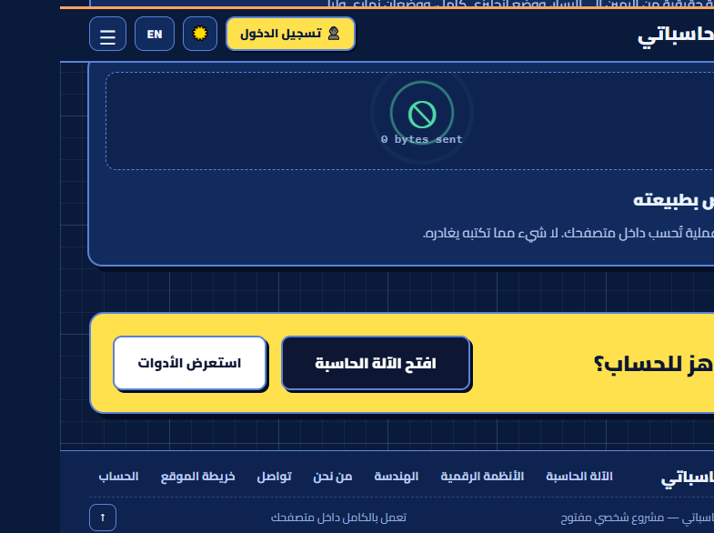
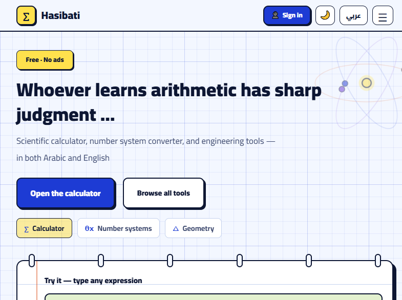
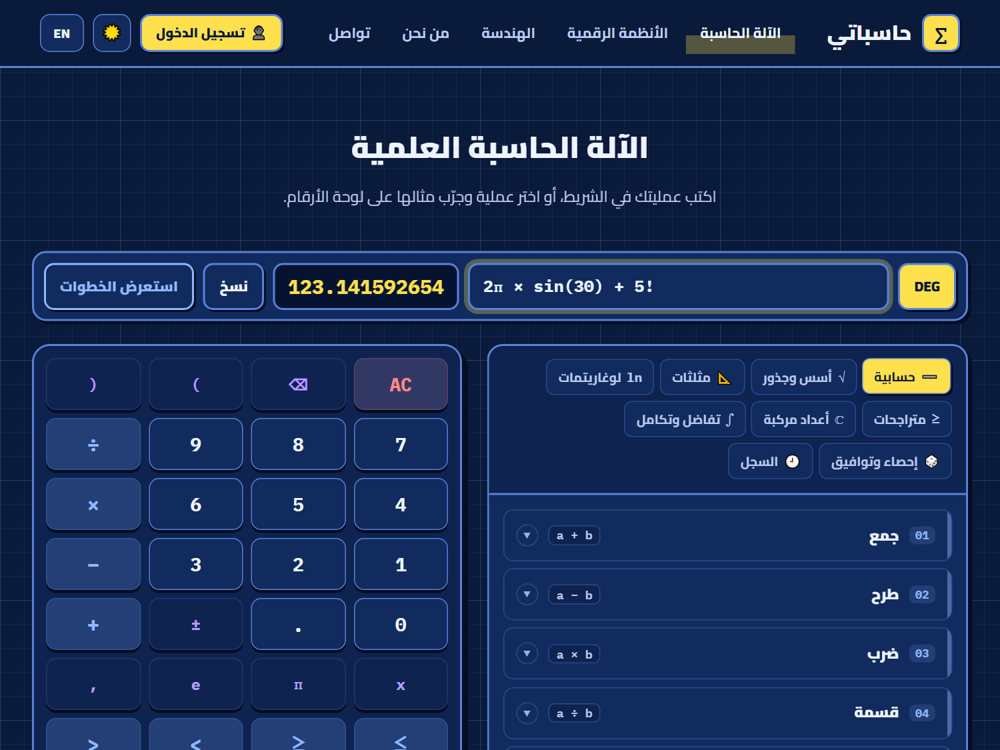
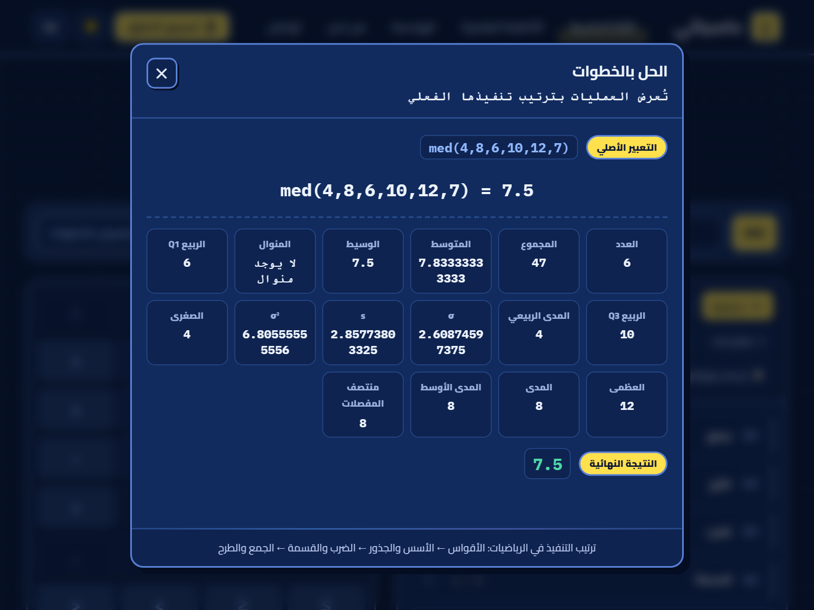
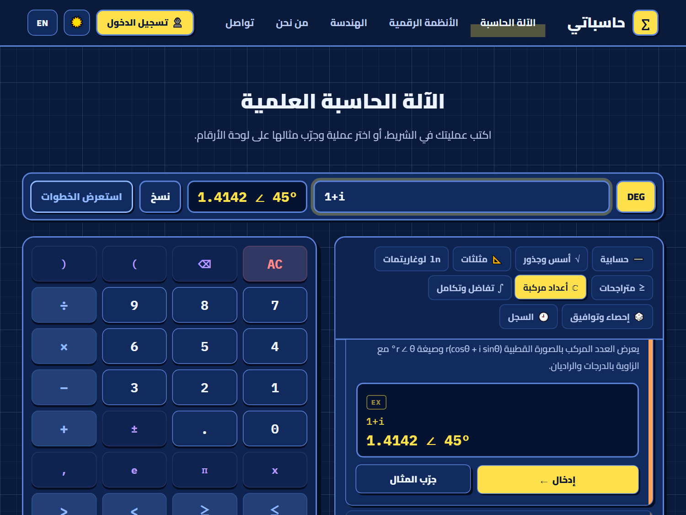
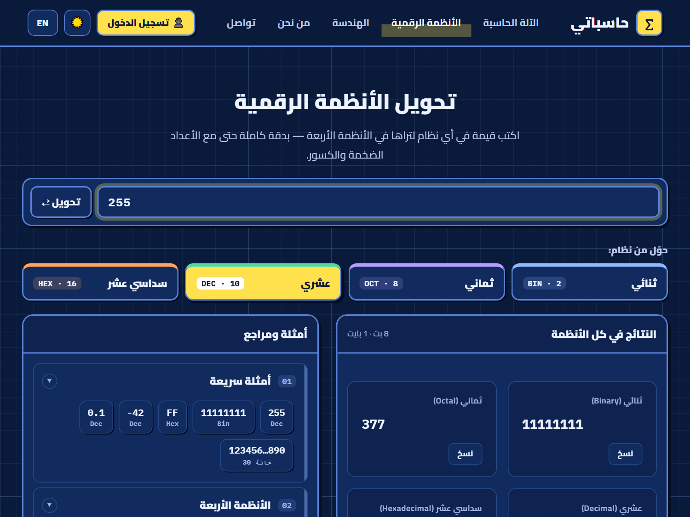
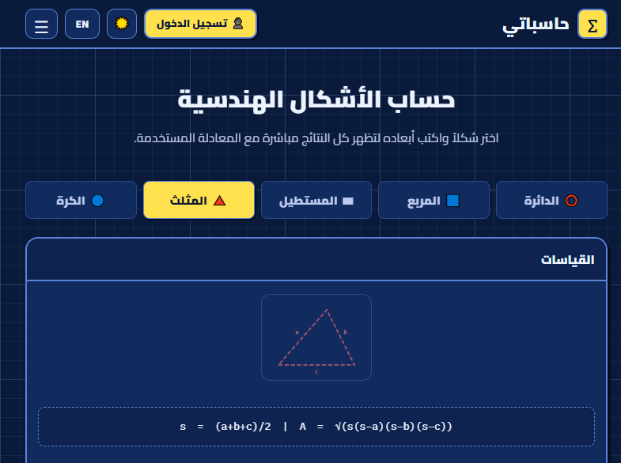

<div align="center">

# 🧮 حاسباتي — Hasibati

**أدوات رياضية وعلمية عربية في المتصفّح — آلة حاسبة علمية، تحويل الأنظمة الرقمية، وحسّاب هندسي.**
**Arabic-first scientific tools: a scientific calculator, a number‑system converter, and a geometry solver.**

[](https://vuejs.org)
[](https://vitejs.dev)
[](https://vitest.dev)
[](#-الاختبارات--tests)
[](#-الميزات--features)
[](#-supabase-اختياري)
[](#-pwa-قابل-للتثبيت--offline)
[](#-الجودة--quality)

</div>

---

> **بالعربية:** حاسباتي مشروع واجهات حقيقية من اليمين إلى اليسار (RTL) بلغتين ووضعين ليلي ونهاري. بُني محرّك الحساب الرياضي **من الصفر بدون `eval`** (محلّل تنازلي تكراري)، ويعمل الموقع بالكامل دون إنترنت ودون إعلانات، وكل عملية تُحسب داخل متصفّح المستخدم.
>
> **In English:** A real RTL Arabic‑first web app with full bilingual support and light/dark themes. The math engine is **hand‑written with no `eval`** (a recursive‑descent parser). Everything runs in the browser — no ads, no tracking, no network required for calculations.

---

## 📸 لقطات الشاشة · Screenshots

<table>
  <tr>
    <td width="50%" align="center">
      <br />
      <sub><b>الصفحة الرئيسية</b> — عربي، الوضع الليلي</sub>
    </td>
    <td width="50%" align="center">
      <br />
      <sub><b>Home</b> — English, light theme</sub>
    </td>
  </tr>
  <tr>
    <td width="50%" align="center">
      <br />
      <sub><b>الآلة الحاسبة</b> — معاينة حيّة + لوحة عمليات</sub>
    </td>
    <td width="50%" align="center">
      <br />
      <sub><b>الإحصاء الوصفي</b> — تقرير كامل داخل نافذة الخطوات</sub>
    </td>
  </tr>
  <tr>
    <td width="50%" align="center">
      <br />
      <sub><b>الأعداد المركبة</b> — الصورة القطبية r∠θ</sub>
    </td>
    <td width="50%" align="center">
      <br />
      <sub><b>الأنظمة الرقمية</b> — دقة BigInt</sub>
    </td>
  </tr>
  <tr>
    <td colspan="2" align="center">
      <br />
      <sub><b>الهندسة</b> — 22 شكلًا (ثنائية وثلاثية الأبعاد) مع شريط قابل للطيّ، والمثلث يُحلّ من أضلاعه ويُصنَّف تلقائيًا (٣-٤-٥ → قائم) + المثلث القائم (فيثاغورس)</sub>
    </td>
  </tr>
</table>

---

## ✨ الميزات · Features

### 🔬 الآلة الحاسبة العلمية
- **محرّك رياضيات مكتوب يدويًا** (محلّل تنازلي تكراري) بلا `eval` — أمان ودقة أوّلية صحيحة.
- المعاينة الحيّة، النسبة المئوية الذكية (`200+10% = 220`)، الضرب الضمني (`2π`، `3(4+1)`)، والدقة `0.1+0.2 = 0.3`.
- مثلثية (درجات/راديان)، لوغاريتمات، جذور، مضروب، ثوابت π وe، تفاضل وتكامل ومجموع وجداء عدديًّا.
- **لوحة عمليات مصنّفة** مع مثال وشرح لكل عملية، وسجلّ عمليات محفوظ، ودعم لوحة المفاتيح كاملة.

### 🧩 عمليات متقدّمة (داخل نفس الآلة)
- **المتراجحات الخطية** — حل بمتغيّر واحد مع الخطوات وقلب الإشارة عند القسمة على سالب.
- **الأعداد المركبة** — تقييم، تحويل إلى الصورة القطبية، الزاوية (الوسيط)، و**إيجاد جميع الحلول المركبة** لمعادلات من الدرجة ≤2 أو الصيغة `xⁿ = k`.
- **الإحصاء الوصفي** — المتوسط، الوسيط، المنوال، الانحراف المعياري (مجتمع/عينة)، التباين، المدى، **المدى الربيعي (H‑Spread)** و**منتصف المفصلات** والمتوسطات الهندسية والتوافقية، مع **تقرير إحصائي كامل**.

### 🔢 محوّل الأنظمة الرقمية
- ثنائي/ثماني/عشري/سداسي عشر بدقة **`BigInt`** (أعداد ضخمة بلا فقدان دقة)، مع السالب والكسور والبادئات `0x / 0b / 0o`.

### 📐 حسّاب الأشكال الهندسية
- **22 شكلًا** في تبويبات: الدائرة، المربع، المستطيل، المثلث، المثلث القائم، المعين، متوازي الأضلاع، شبه المنحرف، المضلع المنتظم، القطع الناقص، القطاع الدائري، الكرة، شبه الكرة، المكعب، متوازي المستطيلات، الأسطوانة، المخروط، الأسطوانة المائلة، الهرم، المنشور، المخروط الناقص، متوازي السطوح المائل — كل نتيجة **مع معادلتها**.
- شريط الأشكال مطويّ افتراضيًا على **سطر واحد** مع زر **«المزيد»** لعرض كل الأشكال (و«أقل» للطيّ مرة أخرى).
- **حلّ المثلث** من أضلاعه الثلاثة (صيغة هيرون) مع التحقق والتصنيف تلقائيًا، و**المثلث القائم (فيثاغورس)**: أدخل أي ضلعين (الساقين، أو الوتر مع ساق) ليُحسب الضلع الثالث.
- **المجسمات** تحسب الحجم والمساحة السطحية والجانبية والأقطار (قطر الوجه والقطر الفضائي)، و**الأشكال المنحنية** تشمل طول القوس والوتر والعامود ونصف قطر الدائرة الداخلية/الخارجية.
- تُعرض الأرقام بمنزلتين عشريتين كحدٍّ أقصى، مع **زر تقريب** تحت كل نتيجة، وتمرير عمودي داخل لوحة النتائج عند كثرتها.

### 🌍 عام
- **عربي/إنجليزي** تفاعلي (تغيّر اللغة فورًا) مع **RTL** أصيل، و**وضعان ليلي ونهاري**، وتصميم متجاوب.
- **PWA قابل للتثبيت ويعمل دون اتصال**: يُثبَّت كتطبيق على الجوال وسطح المكتب، ويعمل بلا إنترنت عبر Service Worker وتخزين مسبق للأصول.
- **إتاحة وصول (a11y) عالية**: تباين ألوان مطابق لـ WCAG AA، أسماء وصولية متطابقة، وترتيب عناوين صحيح.
- **Supabase اختياري**: تسجيل ومزامنة وتخزين سحابي — يعمل الموقع كاملًا بصمت عند غياب الإعداد.

---

## 🛠️ التقنيات · Tech Stack

| الطبقة | التقنية |
|--------|---------|
| الواجهة | Vue 3 (`<script setup>` + SFC) |
| البناء | Vite 5 |
| التوجيه | Vue Router 4 (hash history — يعمل على أي استضافة ثابتة) |
| PWA | vite-plugin-pwa (Service Worker + Web App Manifest) |
| الاختبار | Vitest 2 |
| الخلفية (اختياري) | Supabase (Auth + Postgres) |
| الأنماط | CSS مخصّص (متغيّرات، ثيمات، RTL) — بلا إطار UI |

**أبرز ما يبرزه المشروع:** محلّل تعبيرات مكتوب يدويًا، حساب عالي الدقة بـ `BigInt`، محرّك أعداد مركبة، حلّ خطوة بخطوة، نظام i18n تفاعلي، وطبقة سحابية اختيارية «خاملة بأمان».

---

## 📁 البنية · Project Structure

```
├── index.html                # نقطة الدخول (Vite)
├── vite.config.js            # إعداد Vite + PWA (manifest + workbox)
├── public/
│   ├── css/                  # نظام التصميم (style, theme, calc-ops, components, design)
│   ├── icons/                # أيقونات PWA (192 / 512 / maskable-512)
│   ├── apple-touch-icon.png  # أيقونة iOS
│   └── robots.txt            # توجيهات الزحف
├── src/
│   ├── main.js               # إقلاع التطبيق
│   ├── App.vue               # الشريط العلوي + الفوتر + <router-view>
│   ├── router/index.js       # المسارات (hash history)
│   ├── composables/          # i18n (عربي/إنجليزي) + theme (ليلي/نهاري)
│   ├── services/             # auth + cloud + إعدادات الموقع (Supabase)
│   ├── lib/
│   │   ├── core.js           # MathEngine (محلّل تعبيرات) + BaseConv (BigInt)
│   │   ├── steps.js          # محرّك خطوات الحل
│   │   ├── ineq.js           # حلّ المتراجحات
│   │   ├── complex.js        # محرّك الأعداد المركبة
│   │   ├── calcOps.js        # فئات عمليات الآلة الحاسبة (بيانات ثنائية اللغة)
│   │   └── calcFormat.js     # تنسيق موحّد للأرقام
│   ├── components/           # AppNav, AppFooter, SavedHistory, SheetSolver
│   │   └── Calc*.vue         # مكوّنات الحاسبة: CalcOpsPanel · CalcKeypad · CalcStepsDialog
│   └── views/                # 8 صفحات (home/calculator/numbers/geometry/contact + auth/services)
├── tests/                    # اختبارات الوحدة (Vitest)
├── supabase/                 # schema.sql + SETUP.md لقاعدة البيانات
├── docs/screenshots/         # لقطات الشاشة
├── netlify.toml              # إعداد نشر Netlify
├── .github/workflows/deploy.yml  # نشر تلقائي على GitHub Pages
└── legacy/                   # النسخة القديمة (HTML كلاسيكي) للرجوع إليها
```

### 🗺️ المسارات
| المسار | الصفحة |
|--------|--------|
| `/` | الرئيسية (مع حاسبة تجريبية) |
| `/calculator` | الآلة الحاسبة العلمية |
| `/numbers` | تحويل الأنظمة الرقمية |
| `/geometry` | الأشكال الهندسية |
| `/contact` | تواصل |
| `/login` · `/register` · `/forgot` | الحسابات |
| `/services` | كل الأدوات |

---

## 📊 الجودة · Quality

قياس **Lighthouse** (سطح المكتب، على البناء الإنتاجي) للمسارات الرئيسية — بلغتين وبوضعين:

| الفئة | النتيجة |
|-------|:-------:|
| إتاحة الوصول · Accessibility | **100** |
| أفضل الممارسات · Best Practices | **100** |
| تحسين محركات البحث · SEO | **100** |

تم التحقق عبر **٩ مسارات** في العربية والإنجليزية، بالوضعين الليلي والنهاري (AR/EN × dark/light)، مع خلوّ الطرفية من الأخطاء والتحذيرات.

---

## 📱 PWA (قابل للتثبيت · Offline)

التطبيق **قابل للتثبيت** كتطبيق مستقل، ويعمل **دون اتصال** بعد أول زيارة:

- **Web App Manifest** (اسم، أيقونات 192/512 + maskable، ثيم، اختصارات مباشرة للأدوات الثلاث).
- **Service Worker** (Workbox) يخزّن هيكل التطبيق مسبقًا، مع تخزين مؤقت لخطوط Google.
- تحديث تلقائي (`registerType: 'autoUpdate'`) عند توفّر إصدار جديد.

> يُختبر التثبيت والعمل دون اتصال عبر خادم فعلي (`npm run preview`) — لا تعمل Service Worker عند فتح الملف عبر `file://`.

---

## 🚀 التشغيل · Getting Started

```bash
npm install        # أو npm.cmd install على Windows إن مُنع npm
npm run dev        # خادم تطوير → http://localhost:5173
npm run build      # بناء إنتاجي في dist/
npm run preview    # معاينة البناء الإنتاجي
npm test           # تشغيل الاختبارات (Vitest)
npm run test:watch # الاختبارات في وضع المراقبة
```

> **ملاحظة Windows:** إن حجب PowerShell سكربت `npm`، استخدم `npm.cmd`.

---

## 🧪 الاختبارات · Tests

يفحص المشروع صحّة **محرّك الحساب** و**محوّل الأنظمة** و**الأعداد المركبة** و**المتراجحات** و**خطوات الحل** — بأكثر من **75 اختبارًا**:

```bash
npm test
```

```
 ✓ tests/baseconv.test.js  (10 tests)
 ✓ tests/ineq.test.js      (11 tests)
 ✓ tests/steps.test.js     (13 tests)
 ✓ tests/complex.test.js   (20 tests)
 ✓ tests/core.test.js      (21 tests)

 Test Files  5 passed (5)
      Tests  75 passed (75)
```

---

## ☁️ النشر · Deployment

التطبيق موقع ثابت بالكامل (SPA بـ hash history) — يعمل على أي استضافة ثابتة **دون أي إعداد إضافي**.

**Netlify (الأسرع):** اربط مستودع GitHub على Netlify؛ سيتعرّف تلقائيًا على `netlify.toml` (أمر البناء `npm run build`، مجلد النشر `dist`).

**GitHub Pages:** فعّل `Settings → Pages → Source: GitHub Actions`؛ سيتكفّل `‎.github/workflows/deploy.yml` بالبناء والنشر عند كل دفعة إلى `main`.

**محليًا:** افتح `dist/index.html` مباشرةً بعد البناء (المسارات نسبية).

---

## 🔐 Supabase (اختياري)

الحسابات والتخزين السحابي اختياريان تمامًا، والمفاتيح تُقرأ من **متغيرات البيئة** فلا تُخزَّن في الكود:

1. أنشئ مشروعًا مجانيًا على [supabase.com](https://supabase.com).
2. نفّذ ملف `supabase/schema.sql` (جداول `profiles` و`tool_history` و`contact_messages`).
3. أضف المفتاحين:
   - **للنشر:** أسرار المستودع — `Settings → Secrets and variables → Actions` → `VITE_SUPABASE_URL` و`VITE_SUPABASE_ANON_KEY`.
   - **محليًا:** انسخ `.env.example` إلى `.env` واملأ القيمتين.

التفاصيل خطوة بخطوة في `supabase/SETUP.md`.

**عندما تكون متغيرات البيئة غائبة يعمل الموقع كاملًا بصمت:** لا أخطاء، ولا قيود على الأدوات.

---

## 🗺️ خارطة الطريق · Roadmap

- [ ] نشر مباشر (Netlify / GitHub Pages) + رابط تجربة في الأعلى.
- [ ] توسيع الاختبارات (تغطية إضافية + اختبارات مكوّنات).
- [x] PWA يعمل دون اتصال وقابل للتثبيت.
- [x] مراجعة إتاحة الوصول (a11y) — Lighthouse 100 للمسارات الرئيسية.
- [x] تقسيم `CalculatorView` إلى فئات عمليات مستقلة (بيانات + مكوّنات قابلة لإعادة الاستخدام).
- [ ] مشاركة التعبير عبر الرابط + روابط عميقة للحسابات.

## 📄 الرخصة · License

هذا مشروع شخصي/تعليمي. أضف ملف `LICENSE` (مقترح: MIT) إن رغبت بمشاركته كمصدر مفتوح.

---

<div align="center">
  <sub>صُنع بعناية للعربية أولًا — Built Arabic-first, with care.</sub>
</div>
